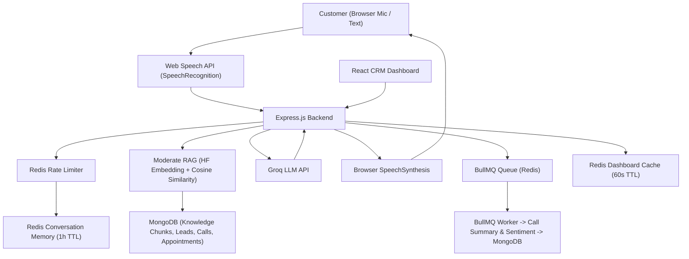
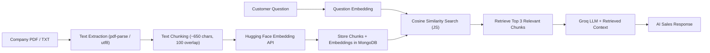

# VoxLead AI – Autonomous AI Sales Voice Agent

VoxLead AI is a beginner-friendly MERN stack MVP of an autonomous AI sales voice agent. It speaks with potential customers using browser voice APIs, answers product and pricing questions from uploaded company documents using **Moderate embedding-based RAG**, remembers active call context in **Redis**, qualifies leads into **Hot / Warm / Cold** in **MongoDB**, books demo appointments, and processes call summaries and sentiment asynchronously with **BullMQ**.

---

## 1. Business Problem & Solution

**The Problem:** Sales teams spend hours answering repetitive product questions, qualifying cold leads, and manually typing notes into a CRM.

**How VoxLead AI Solves It:**
1. **Customer speaks** via the browser microphone (or types in the text fallback).
2. **Express + Redis** loads the active call's conversation history.
3. **Moderate RAG** embeds the question via Hugging Face, runs cosine similarity against uploaded company PDF/TXT chunks in MongoDB, and retrieves the top 3 relevant chunks.
4. **Groq LLM** generates a concise, professional sales response using the retrieved company context.
5. **Browser SpeechSynthesis** speaks the response aloud to the customer.
6. **Lead Qualification** extracts customer details, computes a transparent JavaScript lead score (0–100), and saves the lead in MongoDB.
7. **BullMQ + Redis** processes the post-call summary and sentiment analysis in the background.

---

## 2. Why This Tech Stack?

- **MongoDB + Mongoose:** Stores permanent business data — `Lead`, `Call`, `Appointment`, and `KnowledgeDocument` (chunks + embeddings).
- **Express.js + Node.js:** Simple REST APIs, Multer file uploads, and Groq/Hugging Face integration.
- **React + Vite + Tailwind CSS:** Fast dark-themed SaaS CRM dashboard and voice interface.
- **Redis (`redis` + `ioredis` + `bullmq`):**
  1. **Conversation Memory:** Stores active call messages (`call:<callId>:messages`) with a 1-hour TTL.
  2. **Dashboard Caching:** Caches `/api/dashboard/stats` for 60 seconds and invalidates on new leads, calls, or appointments.
  3. **Background Jobs:** Powers BullMQ queues (`call-analysis`) for async call summaries and sentiment analysis.
  4. **API Rate Limiting:** Protects `/api/ai/*` endpoints from excessive requests.
- **Groq API:** Ultra-fast LLM inference for sales replies, lead extraction, and call summarization.
- **Hugging Face Inference API:** Generates vector embeddings (`sentence-transformers/all-MiniLM-L6-v2`) for Moderate RAG.

---

## 3. System Architecture



### Moderate RAG Workflow



*(If `HUGGINGFACE_API_KEY` is missing or the embedding API fails, the system honestly falls back to keyword-overlap retrieval instead of pretending embedding retrieval succeeded.)*

---

## 4. Project Structure

```text
voxlead-ai/
├── client/                     # React + Vite + Tailwind frontend
│   ├── src/
│   │   ├── components/Layout.jsx
│   │   ├── pages/
│   │   │   ├── Dashboard.jsx
│   │   │   ├── VoiceAgent.jsx
│   │   │   ├── LeadsCRM.jsx
│   │   │   ├── Appointments.jsx
│   │   │   ├── KnowledgeBase.jsx
│   │   │   └── CallHistory.jsx
│   │   ├── services/api.js
│   │   ├── App.jsx
│   │   └── main.jsx
│   └── package.json
├── server/                     # Node.js + Express backend
│   ├── config/
│   │   ├── db.js               # MongoDB connection
│   │   └── redis.js            # Redis connection & status
│   ├── controllers/            # Route handlers
│   ├── middleware/
│   │   └── rateLimiter.js      # Redis-backed AI rate limiter
│   ├── models/                 # Mongoose schemas
│   ├── queues/
│   │   └── callQueue.js        # BullMQ queue
│   ├── routes/                 # Express REST routes
│   ├── services/
│   │   ├── cacheService.js     # Redis memory & dashboard cache
│   │   ├── embeddingService.js # Hugging Face embedding API
│   │   ├── groqService.js      # Groq chat, lead extraction, JS scoring, summary
│   │   └── ragService.js       # Cosine similarity + keyword fallback
│   ├── utils/
│   │   ├── similarity.js       # Cosine & keyword similarity helpers
│   │   └── textChunker.js      # Overlapping text chunker
│   ├── workers/
│   │   └── callWorker.js       # BullMQ background worker
│   ├── server.js
│   └── package.json
├── .env.example
└── README.md
```

---

## 5. Local Installation (Windows, No Docker Required)

### Step 1: Clone & Install Dependencies
```bash
# Backend
cd server
npm install

# Frontend
cd ../client
npm install
```

### Step 2: Configure Environment Variables
Copy `.env.example` to `.env` in the project root:
```env
PORT=5000
MONGODB_URI=mongodb://127.0.0.1:27017/voxlead_ai
REDIS_URL=redis://127.0.0.1:6379
GROQ_API_KEY=your_groq_api_key_here
HUGGINGFACE_API_KEY=your_huggingface_api_key_here
CLIENT_URL=http://localhost:5173
```

- **MongoDB:** Install MongoDB Community Server locally or create a free cluster on [MongoDB Atlas](https://www.mongodb.com/atlas).
- **Redis on Windows (No Docker):**
  - Option A (Hosted, Easiest): Create a free Redis database on [Upstash](https://upstash.com/) or [Redis Cloud](https://redis.com/try-free/) and paste the `redis://` or `rediss://` URL into `REDIS_URL`.
  - Option B (Local Windows): Install [Memurai](https://www.memurai.com/) (Redis-compatible for Windows) or run `sudo apt install redis-server && sudo service redis-server start` inside WSL2.
- **Groq API Key:** Create a free key at [console.groq.com](https://console.groq.com).
- **Hugging Face API Key:** Create a free Read token at [huggingface.co/settings/tokens](https://huggingface.co/settings/tokens).

### Step 3: Run the Application
```bash
# Terminal 1 - Start Express Backend + BullMQ Worker
cd server
npm run dev

# Terminal 2 - Start React Frontend
cd client
npm run dev
```
Open `http://localhost:5173` in Chrome or Edge (recommended for Web Speech API).

---

## 6. REST API Endpoints

| Method | Endpoint | Description |
|---|---|---|
| `GET` | `/api/health` | Check MongoDB, Redis, Groq, and HF config status |
| `POST` | `/api/ai/chat` | Voice/text turn (Redis memory + Moderate RAG + Groq) |
| `POST` | `/api/ai/qualify-lead` | Extract lead fields, compute JS score, save to MongoDB |
| `POST` | `/api/ai/summarize-call` | Direct call summary & sentiment |
| `GET` | `/api/leads` | List leads (supports `?search=` and `?status=`) |
| `GET/POST/PUT` | `/api/leads/:id` | Get, create, or update a lead |
| `POST/GET` | `/api/calls` | Save call & enqueue BullMQ job; list call history |
| `POST` | `/api/knowledge/upload` | Upload PDF/TXT, chunk, embed, store in MongoDB |
| `GET/DELETE` | `/api/knowledge` | List or delete knowledge base documents |
| `GET/POST/PUT` | `/api/appointments` | View slots, book demo (prevents double-booking), update status |
| `GET` | `/api/dashboard/stats` | CRM stats (Redis 60s cache + MongoDB fallback) |

---

## 7. Scalability Strategy for 100,000 Users

> **Important Distinction:** Supporting **100,000 registered users** (who log in occasionally) is very different from **100,000 simultaneous active voice calls** (which would require massive AI API concurrency, WebRTC/telephony media servers, and horizontal auto-scaling). This MVP is designed for single-server demonstration and needs the following upgrades for production scale:

| Component | Current MVP | Future Production Upgrade (100k Users) |
|---|---|---|
| **Backend** | Single Node.js/Express server | Multiple stateless Node.js instances behind a Load Balancer (NGINX / AWS ALB) |
| **Database** | Single MongoDB instance | MongoDB Atlas Replica Sets for high availability + Sharding for large collections |
| **Vector Search** | JavaScript cosine similarity in memory | **MongoDB Atlas Vector Search** (`$vectorSearch` index) so similarity runs inside the database |
| **Redis** | Local or single-instance Redis | Managed Redis Cluster (Upstash / Redis Enterprise) for sessions, caching, and queues |
| **Background Jobs** | BullMQ worker inside `server.js` | Dedicated BullMQ worker processes scaled independently from the web API |
| **Frontend** | Local Vite dev server | Static bundle served globally via CDN (Vercel / Cloudflare) |
| **AI Limits** | Per-IP 30 req/min rate limiter | Tiered rate limiting, request queuing, token budgets, and fallback LLM providers |
| **Monitoring** | Console logs | Centralized logging & APM (Datadog, Sentry, Prometheus/Grafana) |

---

## 8. Security & Deployment

- **Secrets:** All API keys (`GROQ_API_KEY`, `HUGGINGFACE_API_KEY`, `MONGODB_URI`, `REDIS_URL`) live in `.env` on the backend and are never exposed to React.
- **Consent:** The Voice Agent UI includes an explicit customer consent checkbox before starting a call.
- **Deployment:**
  - **Frontend:** Deploy `client/` to **Vercel** (set `VITE_API_URL` to your Render backend URL).
  - **Backend:** Deploy `server/` to **Render** (add `MONGODB_URI`, `REDIS_URL`, `GROQ_API_KEY`, `HUGGINGFACE_API_KEY`, `CLIENT_URL` in Render Environment Variables).
  - **Database & Redis:** Use **MongoDB Atlas** and **Upstash / Redis Cloud** over TLS (`rediss://`).
